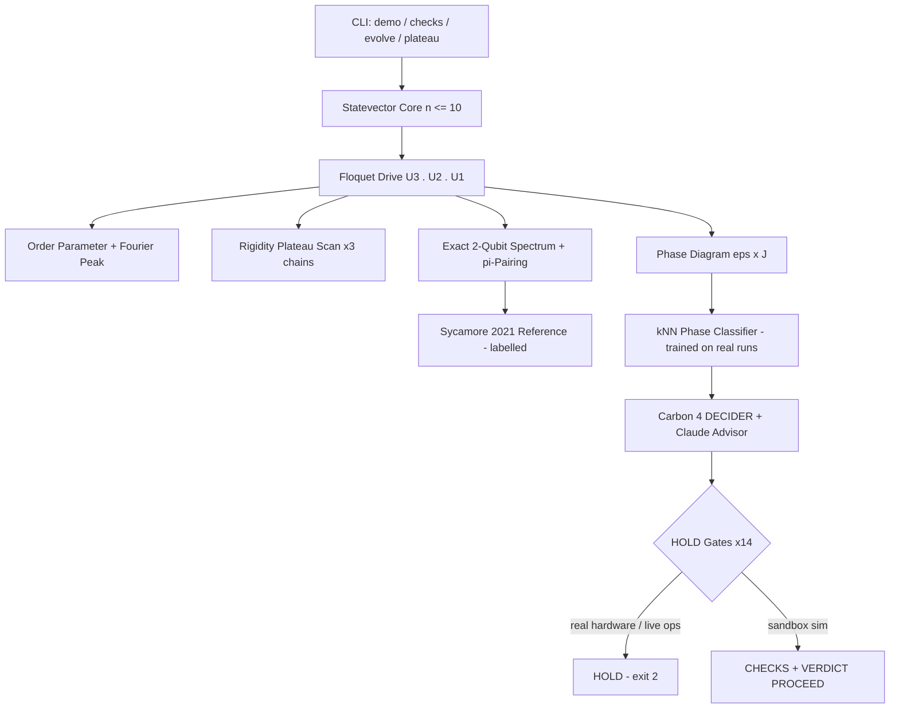
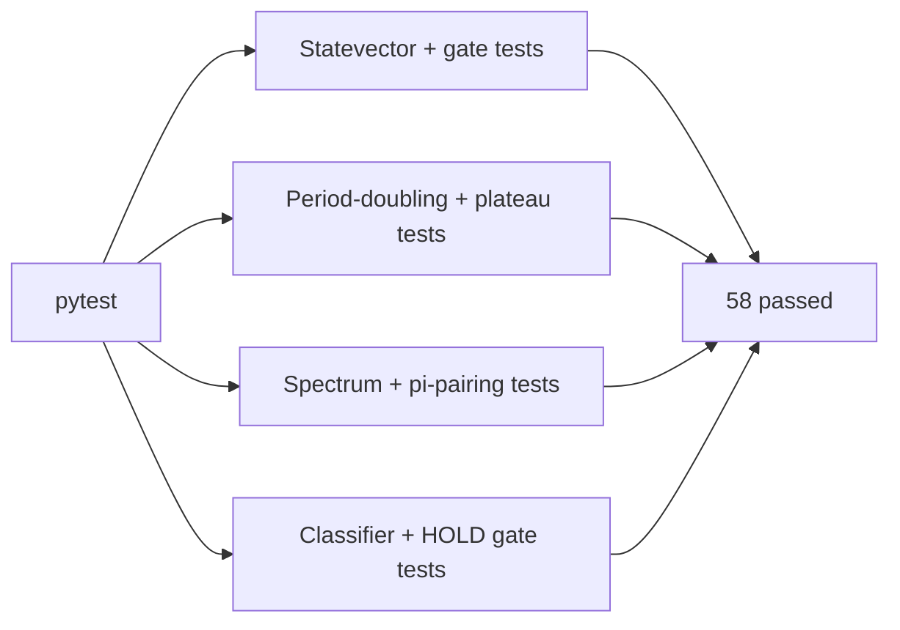
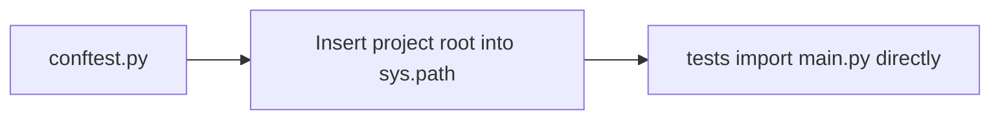
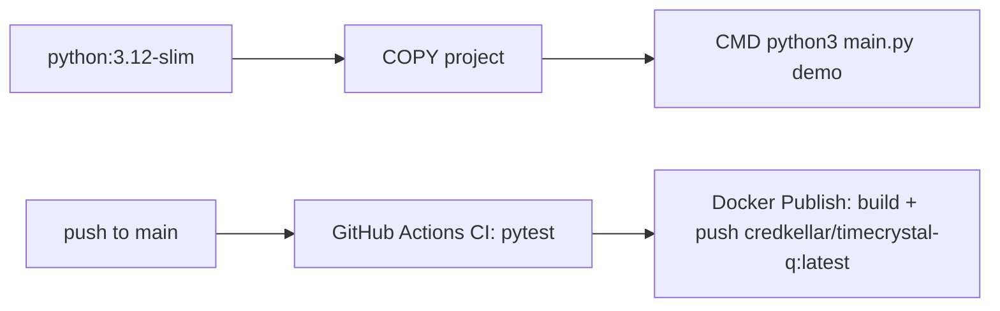

# TimeCrystal-Q ⏳💎

**Discrete Time Crystal Physics Lab** — an educational discrete time crystal (DTC) lab in ONE pure-Python file, by Darion Kellar. A periodically driven (Floquet) spin chain, simulated **exactly** with a small statevector core (≤ 10 qubits), that breaks the time-translation symmetry of its own drive: kick it once per period and it answers at **twice the period**. The lab covers the imperfect π-pulse (flip error ε), the **rigid plateau** where period doubling survives it, the load-bearing role of **interactions** (and, in the thermodynamic limit, disorder-driven many-body localisation), the stroboscopic **order parameter**, a **phase-diagram** sweep (DTC / thermal / trivial), an exact 2-qubit Floquet spectrum with **π-paired quasienergies**, and an honest side-by-side with the **2021 Google Sycamore** experiment (published reference values only). Simulation and learning only — no hardware, no QPU jobs, no experimental claims; every real-world operation sits behind a permanent HOLD gate (14 total). 🔒


> ℹ️ The two workflow badges above are the **live** GitHub Actions badges for this repo — they light up as soon as the `ci.yml` and `docker-publish.yml` files from the paste pack are pasted into `.github/workflows/`.

## 🧰 Tech Stack Badges & Full Architecture Tech Stack

### 💻 Core Programming Languages & Core Systems


- 🐍 Python 3.12, pure standard library (`math`, `cmath`, `random`, `hashlib`, `json`, `sys`) — ONE file: `main.py`
- ⚛️ Physics core: exact statevector evolution of the kicked-Ising Floquet unitary U_F = U3·U2·U1, subharmonic order parameter A = |(1/N) Σ (−1)^k m[k]|, Fourier peak analysis, exact 2-qubit diagonalisation (characteristic polynomial via Newton's identities, roots via Durand–Kerner), π-pairing of quasienergies
- 🧠 TinyML kNN phase classifier (from scratch, stdlib) whose training labels come from **actual small simulations**, not a hand-written rule
- 🧑‍⚖️ Advisory seats inside `main.py`: Gemini Carbon 4 DECIDER (names-only, tighten-only, sha256 trace), Muse advisor (can_override_hold = False), Google Flow plan-only (rendered = False, live = 0)

### ⛓️ Web3 & Infrastructure

Not used — this lab is an offline physics simulation. No blockchain, no Web3 libraries, no network calls of any kind.

### ⚙️ Platform Support & Hardware Architecture


- 🖥️ Runs anywhere Python 3.12 runs — Linux, macOS, Windows, any CPU architecture
- 🚫 Controls **no quantum hardware**: no QPUs, no pulse electronics, no cryostats (all behind HOLD gates)

### ⚡ Low-Level Infrastructure & Performance


- 🚀 Zero dependencies, zero network, zero install friction for the lab itself
- 🎯 Deterministic end to end: seeded disorder, run it twice, get byte-identical output

### 🛠️ DevOps & Build Tools


- 🐳 Docker image (`python:3.12-slim`), target: `credkellar/timecrystal-q:latest`
- ⚙️ GitHub Actions CI + Docker Publish workflows — delivered in the paste pack for `.github/workflows/`

### ☁️ Cloud Providers

Not used — this lab runs fully offline on your own machine or in a local Docker container. No cloud account, no API keys, no hosted services, and **no quantum cloud**: QPU job submission is a permanent HOLD gate.

## What this does?

1. 🎛️ **The Floquet drive** — one period is U_F = U3·U2·U1: a global π-pulse flip (U1, angle π·g), disordered nearest-neighbour Ising phases around J = π/4 (U2, the interactions), and random on-site fields in [−π, π] (U3, the disorder). This is the kicked-Ising model of the Sycamore time-crystal experiment.
2. 🔁 **Period doubling** — start all spins up, drive with the perfect pulse (ε = 0), and the magnetisation answers −1, +1, −1, +1 … — the system responds at **half the drive frequency**, breaking the drive's time-translation symmetry.
3. 📏 **Order parameter** — the subharmonic amplitude A = |(1/N) Σ (−1)^k m[k]|: exactly 1.0 for perfect doubling, ~0 when the response melts. Plus persistence (late-time memory) and a Fourier spectrum whose power piles up at exactly half frequency (share > 0.99 for the perfect run).
4. 🎚️ **Imperfect pulses** — real pulses miss: g = 1 − ε. Sweep ε and watch what survives. A lone detuned spin precesses and forgets; the interacting, disordered chain **locks** the error into a rigid plateau.
5. 🏔️ **Rigidity plateau** — A vs ε for three chains: interactions + disorder holds A ≥ 0.5 out to ε ≈ 0.125; disorder alone (J = 0) collapses by ε ≈ 0.025; the clean chain (W = 0) also answers at this size — a **prethermal finite-size effect, labelled honestly**, not the thermodynamic phase.
6. 🗺️ **Phase diagram** — a real (ε, J) sweep at strong disorder, every cell labelled by an actual run: a DTC island at small ε and finite J, melting to thermal / trivial at large ε or J = 0 (15 DTC / 2 thermal / 7 trivial cells on the default grid).
7. 🎼 **Exact Floquet spectrum** — for 2 qubits the full U_F is built column by column and diagonalised exactly: quasienergies 0.6208, 2.5208, 3.7623, 5.6624 rad — two pairs, each split by **exactly π** (pairing error 0.0 at g = 1; 0.051 at g = 0.9, where the pairing melts). At g = 1, U_F² is exactly diagonal (off-diagonal max ~1e-16) — the algebraic reason the pairing is exact.
8. 🔬 **Sycamore 2021, honestly** — Mi et al., Nature 600, 531–536 (2021): 20 real qubits, real noise, up to ~100 cycles. This lab: ≤ 10 qubits, exact, noiseless, zero hardware — a reproduction of the **mechanism**, never a replication of the experiment. The reference values are labelled literature, not measurements.
9. 🏷️ **kNN phase classifier** — labels any (ε, J, W) point DTC / thermal / trivial. Its 54 training points are labelled by **actual n = 5 simulations** run through the same classifier used everywhere else — the ML learns the phase boundary from real runs.
10. 🧠 **Advisory seats + checks** — Carbon 4 DECIDER with sha256 trace, Muse advisor, Google Flow plan-only, and a built-in CHECKS suite (41 checks) that pins every headline number above.

## 🗺️ How it works — diagram per script

### `main.py` — the whole lab



### `tests/test_main.py` — verification



### `conftest.py` — test path setup



### `Dockerfile` + CI — container & workflow flow



## Why is this cool?

1. 🕰️ A clock that ticks at half speed: drive the chain every period and it answers every **two** periods — time itself gets a crystal lattice.
2. 🎯 The doubling is not approximate: at ε = 0 the subharmonic amplitude is exactly 1.0 and the Fourier power at half frequency is > 0.99 of all power.
3. 🏔️ Rigidity you can measure: the plateau width is a number (ε ≈ 0.125 with interactions vs ≈ 0.025 without), not a vibe.
4. 🎼 The spectrum confesses: quasienergies pair up π apart with pairing error 0.0 — the fingerprint is exact algebra (U_F² diagonal), not curve-fitting.
5. 🧩 Interactions are load-bearing, proven by deletion: set J = 0 and the same drive, same disorder, same error melts (A 0.71 → 0.16).
6. 🥋 Honesty about its own limits: the clean chain's stubborn answer is labelled **prethermal finite-size**, not dressed up as the thermodynamic phase — the lab shows its own limits.
7. 🔬 It reproduces the *mechanism* of a Nature paper on a laptop with zero installs — and says exactly where the reproduction stops (20 noisy real qubits vs ≤ 10 exact simulated ones).
8. 🏷️ The ML classifier's training labels come from real simulations, so the phase boundary it draws is measured, not hand-drawn.
9. 🧮 Exact diagonalisation with no numpy: characteristic polynomials from traces of powers, roots by Durand–Kerner — 19th-century math, stdlib only.
10. 🎯 Deterministic end to end: seeded disorder means run it twice, get byte-identical output — physics you can diff.

## What problems this solves?

1. ❌ **Problem:** "Time crystal" sounds like sci-fi perpetual motion. ✅ **Solution:** The lab shows the precise, boring, beautiful definition — a driven system answering at a subharmonic of its drive — computed exactly, cycle by cycle.
2. ❌ **Problem:** Period doubling gets claimed from any wobbly oscillation plot. ✅ **Solution:** A real order parameter (subharmonic amplitude + Fourier share + persistence) with thresholds, applied uniformly to every run.
3. ❌ **Problem:** Why doesn't pulse error kill it instantly? Nobody shows the plateau. ✅ **Solution:** The ε-sweep prints the plateau and its width for three chains, so rigidity is a measured interval, not a claim.
4. ❌ **Problem:** The role of interactions is usually asserted, not demonstrated. ✅ **Solution:** The J = 0 control run melts under identical conditions — the contrast is the proof.
5. ❌ **Problem:** Finite-size simulations get oversold as thermodynamic phases. ✅ **Solution:** The clean chain's prethermal answer is labelled a finite-size effect in the demo, the checks, and this README.
6. ❌ **Problem:** π-pairing of quasienergies is quoted as mystique. ✅ **Solution:** The lab proves it in algebra (U_F² is diagonal at g = 1) and verifies it numerically to 0.0 error, then shows it melting at g = 0.9.
7. ❌ **Problem:** The Sycamore result is either hyped ("quantum supremacy of time") or dismissed. ✅ **Solution:** A labelled side-by-side: same model, honest differences (qubits, noise, hardware), no advantage claim anywhere — it's a HOLD gate.
8. ❌ **Problem:** Quantum software usually needs a heavyweight stack (Qiskit, numpy, a cloud account). ✅ **Solution:** Pure standard library — an exact statevector core in a few dozen lines, runs anywhere Python 3.12 runs.
9. ❌ **Problem:** Phase diagrams in textbooks are cartoons. ✅ **Solution:** Every cell of this one is an actual simulation, and the kNN boundary is interpolated from 54 more real runs.
10. ❌ **Problem:** Simulation tools quietly imply experimental readiness. ✅ **Solution:** Simulation output is never presentable as measured data (a HOLD gate), reference values are labelled literature, and 14 HOLD gates return exit code 2 for every live operation.

## How to install this?

1. 📥 Clone the repo:

```bash
git clone https://github.com/kimanicollier44-cmyk/TimeCrystal-Q.git
cd TimeCrystal-Q
```

2. 🐍 Make sure Python 3.12+ is installed: `python3 --version`
3. ▶️ Run the full demo + checks (no arguments needed):

```bash
python3 main.py
```

4. 🧪 Run the test suite:

```bash
pip install pytest
python3 -m pytest -q
```

5. 🎛️ Try the other commands:

```bash
python3 main.py checks     # 41 built-in checks
python3 main.py evolve     # one DTC run, full diagnostics as JSON
python3 main.py plateau    # rigidity plateau scan (3 chains)
python3 main.py phase      # (epsilon, J) phase diagram
python3 main.py spectrum   # 2-qubit quasienergies + pi-pairing errors
python3 main.py sycamore   # lab vs published experiment, side by side
python3 main.py classify   # kNN verdicts at reference points
python3 main.py brains     # Carbon 4 + Muse + Flow seats
python3 main.py holds      # list all 14 HOLD gates
python3 main.py hold-demo  # exits 2 - gated actions stay HOLD
```

6. 🐳 Or run it in Docker:

```bash
docker build -t credkellar/timecrystal-q:latest .
docker run --rm credkellar/timecrystal-q:latest
```

## Requirements

- 🐍 Python 3.12 or newer — standard library only
- 📦 Dependencies: **none**
- 🌐 Network: **none** — fully offline
- 🧪 Optional, for tests only: `pytest`
- 🐳 Optional: Docker

## FULL project structure tree

```text
timecrystal-q/
├── main.py                  # the whole lab: statevector core, Floquet drive, order parameter, plateau, phase diagram, exact spectrum, classifier, seats, HOLD gates
├── conftest.py              # puts the project root on sys.path for tests
├── tests/
│   └── test_main.py         # 58 pytest tests: statevector, doubling, plateau, spectrum, pairing, classifier, gates, determinism
├── assets/
│   └── cover.png            # README cover image (2736 x 912)
├── Dockerfile               # python:3.12-slim, runs the demo
├── .gitignore               # Python cache / venv ignores
└── README.md                # this file
```

> 📦 Delivered separately as paste packs (not in this tree): `.github/workflows/ci.yml` + `docker-publish.yml`, and the Docker Hub pack (100-char description, 350-char About, overview, categories).

## 🔒 HOLD gates — all 14, permanent

| Gate | What stays held |
|---|---|
| `real_quantum_hardware` | No control of, or jobs on, real quantum hardware |
| `live_experiment_control` | No live control of any physics experiment |
| `qpu_job_submission_live` | No job submission to any quantum cloud / QPU service |
| `pulse_calibration_live` | No calibration of real control pulses or electronics |
| `cryogenic_system_control` | No control of cryostats, dilution fridges, or cryogenics |
| `hardware_fabrication_design` | No chip / device fabrication design output |
| `experimental_data_claim` | Simulation output is never presented as measured experimental data |
| `quantum_advantage_claim` | No quantum-advantage / supremacy claim; this is a ≤10-qubit exact sim |
| `peer_reviewed_result_claim` | No claim that lab results are peer-reviewed findings |
| `commercial_product_claim` | No claim this simulation is a commercial product or certified tool |
| `investment_advice_claim` | No investment advice about quantum companies or hardware |
| `weapons_application_claim` | No weapons or military application claims |
| `medical_application_claim` | No medical or clinical application claims |
| `live_telemetry_ingest` | No ingestion of live telemetry from real devices |

🧑‍⚖️ **Council seats:** Gemini Carbon 4 DECIDER (names-only, tighten-only, MAP→MODEL→STRESS→DECIDE, sha256 trace) · Muse advisor (`can_override_hold = False`) · Google Flow plan-only (rendered = False, live = 0).

✅ **Verification:** pytest **58 passed** · built-in **CHECKS 41/41** · `python3 main.py` → VERDICT PROCEED (sandbox simulation only) · double-run byte-identical · hold-demo exits 2.

## 🧒 5th-grade English section

Imagine you push a swing once every second, but the swing only swings back every **two** seconds — and it keeps doing that even when your pushes are a little bit sloppy. ⏳

- A normal thing copies your rhythm. A **time crystal** makes its own slower rhythm and sticks to it. That is the whole trick — and it is real physics, printed in the science journal *Nature*. 💎
- The pushes are tiny flips. A perfect flip turns every arrow upside down. Next push flips them back. The arrows answer at half speed. 🔁
- If your flip is a tiny bit wrong, a lone arrow slowly forgets and wanders off. But when the arrows **hold onto each other** (interactions) and each one sits in its own messy little pocket (disorder), they **lock together** and keep the slow rhythm anyway. That stubbornness is called **rigidity**. 🏔️
- Google really did this in 2021 with a real quantum chip and 20 quantum bits. This lab is a **pretend version on a normal computer** with at most 10 pretend bits — it shows the same trick, but it is not the real experiment, and the lab says so right on the box. 💻
- This project does not run any real quantum machine. It helps you learn how a crystal can exist in **time**, not just in space. 🧠

---

MIT © 2026 Darion Kellar · TimeCrystal-Q — educational simulation only ⏳
